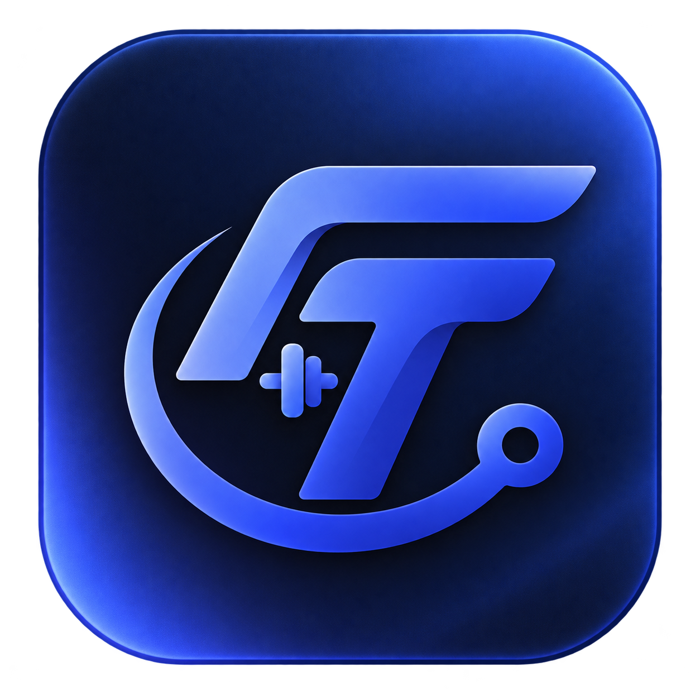
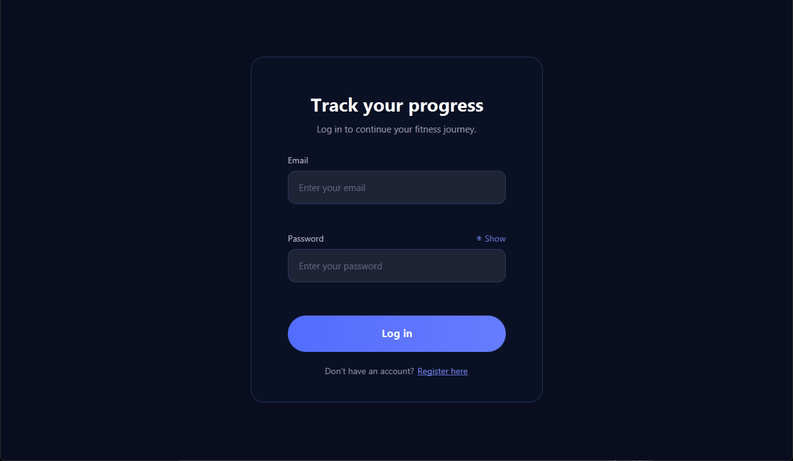
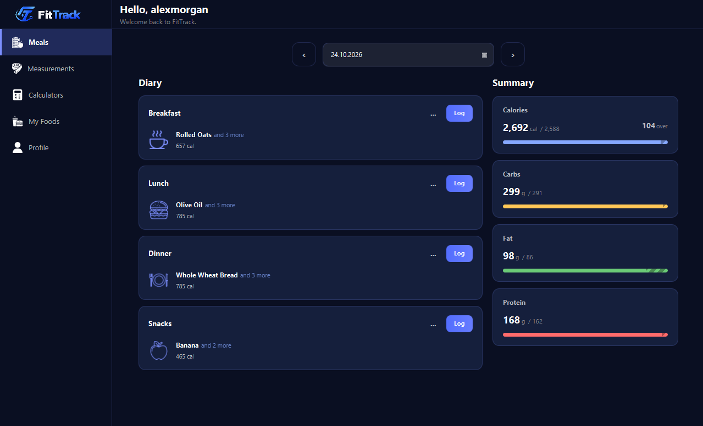
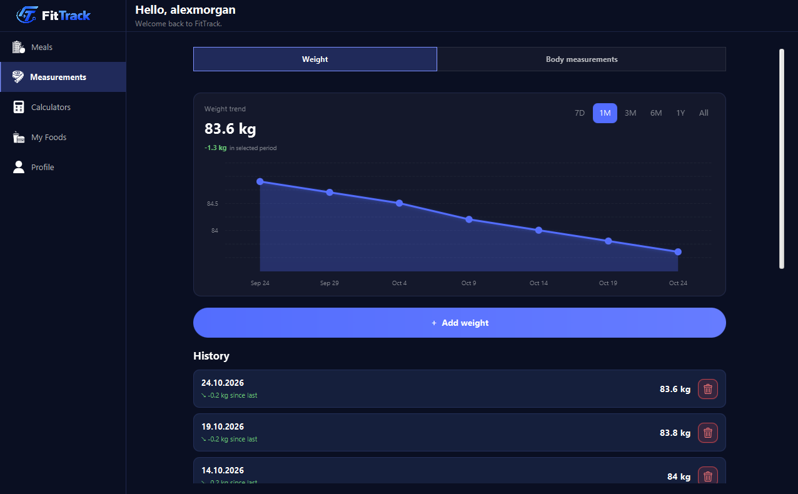
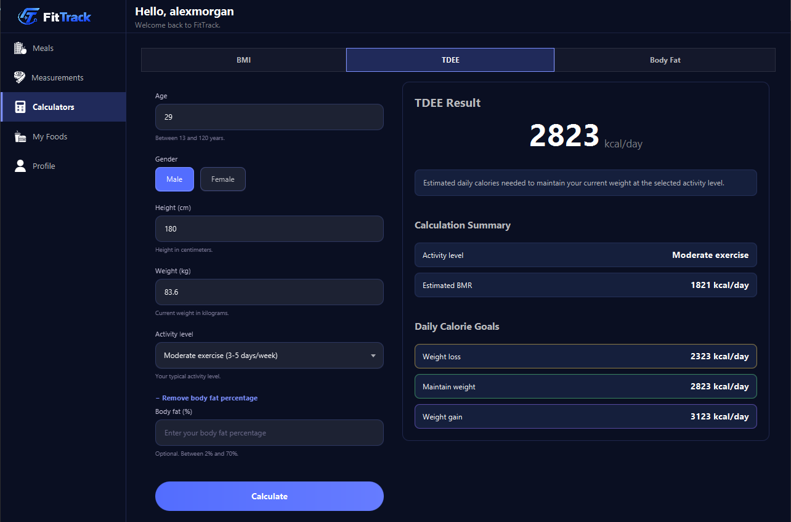
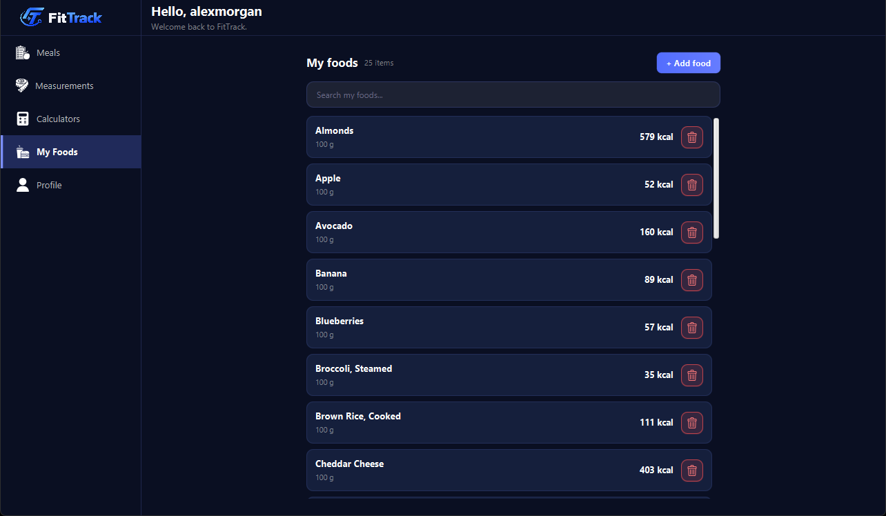
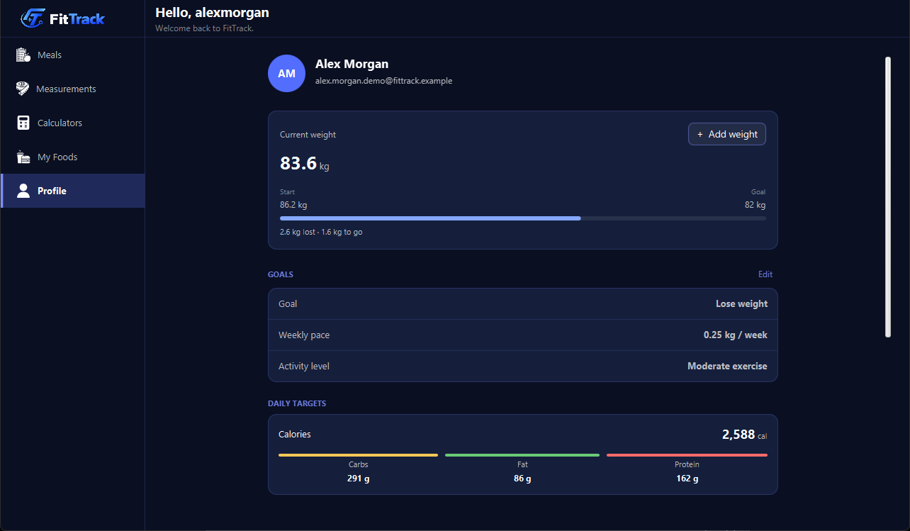
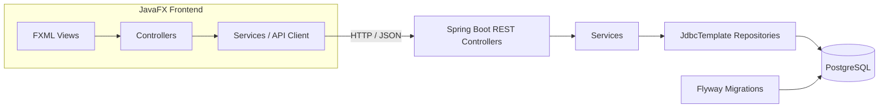

<div align="center">
  

# FitTrack

**A desktop application for nutrition tracking, body measurements, and fitness calculations.**


FitTrack is a university Object-Oriented Programming project built with a JavaFX desktop client, a Spring Boot REST API, and PostgreSQL.

</div>

## Overview

FitTrack brings food logging, nutrition goals, body measurement history, and fitness calculators into one desktop application. Its JavaFX client communicates with a separate REST backend responsible for business logic, validation, and data persistence.

## Features

### Accounts and Profile
- User registration and login with BCrypt password hashing
- Initial profile setup and personal information management
- Nutrition goals and calculated calorie and macronutrient targets

### Nutrition Tracking
- Daily food diary organized into breakfast, lunch, dinner, and snacks
- Calorie and macronutrient summaries with goal progress
- Food search and user-created foods
- Customizable serving sizes and quantities
- Adding, editing, and removing meal items
- Saved meals and reuse of meal contents
- Meal history and copying meals between dates

### Measurements and Progress
- Weight logging and history
- Waist, neck, and hip measurements
- Editing and deleting recorded measurements
- Progress charts with selectable time periods

### Fitness Calculators
- **BMI:** body mass index, category, and related weight indicators
- **TDEE:** basal metabolic rate, activity adjustment, and calorie targets
- **Body fat:** U.S. Navy method and body composition indicators

## Screenshots

### Login


### Meals


### Measurements


### Calculators


### My Foods


### Profile

## Architecture

FitTrack uses a client-server architecture with separate desktop and backend modules.



The frontend handles navigation, UI state, input, and HTTP communication. The backend handles business rules, validation, and persistence. Data access uses **Spring JDBC (`JdbcTemplate`) with parameterized SQL**, rather than JPA/Hibernate. **Flyway** manages database schema migrations.

## Technology Stack

| Area                | Technology                                                 |
|---------------------|------------------------------------------------------------|
| Language            | Java 22                                                    |
| Desktop UI          | JavaFX 22, FXML, CSS                                       |
| Backend             | Spring Boot 4.1.1, Spring Web MVC                          |
| HTTP / JSON         | Java `HttpClient`, Jackson 3                               |
| Data access         | Spring JDBC / `JdbcTemplate`                               |
| Database            | PostgreSQL                                                 |
| Database migrations | Flyway                                                     |
| Validation          | Jakarta Bean Validation                                    |
| Password hashing    | BCrypt (`jBCrypt`)                                         |
| Build and packaging | Maven Wrapper, Maven Shade Plugin, `jpackage`, WiX Toolset |

## Project Structure

```text
OOP-Project/
├── frontend/
│   ├── src/main/java/com/fittrack/         # JavaFX client
│   ├── src/main/resources/                 # FXML, CSS, images, fonts
│   ├── packaging/                          # Windows icon and packaging script
│   ├── pom.xml
│   ├── mvnw
│   └── mvnw.cmd
├── backend/
│   ├── src/main/java/com/fittrack/backend/ # REST API and application logic
│   ├── src/main/resources/db/migration/    # Flyway migrations
│   ├── pom.xml
│   ├── mvnw
│   └── mvnw.cmd
├── docs/screenshots/                       # Application screenshots (to be added)
└── README.md
```

## Getting Started

### Requirements

- **JDK 22**
- **PostgreSQL** (local or hosted) and credentials for an accessible database
- **Git**

Maven does not need to be installed separately; both modules include the Maven Wrapper.

### 1. Clone the Repository

```bash
git clone https://github.com/Arandjeloviicc/OOP-Project.git
cd OOP-Project
```

### 2. Prepare the Database

Create an empty PostgreSQL database (for example, `fittrack`). Flyway applies the project's SQL migrations when the backend starts. The database user must have the permissions needed by those migrations.

### 3. Configure the Backend

The backend reads its database connection from environment variables:

| Variable      | Description                                             |
|---------------|---------------------------------------------------------|
| `DB_URL`      | PostgreSQL JDBC URL, starting with `jdbc:postgresql://` |
| `DB_USERNAME` | Database username                                       |
| `DB_PASSWORD` | Database password                                       |

**Windows PowerShell:**

```powershell
$env:DB_URL = "jdbc:postgresql://localhost:5432/fittrack"
$env:DB_USERNAME = "postgres"
$env:DB_PASSWORD = "your_password"
```

**Linux / macOS:**

```bash
export DB_URL="jdbc:postgresql://localhost:5432/fittrack"
export DB_USERNAME="postgres"
export DB_PASSWORD="your_password"
```

Use credentials for your own database and keep them out of the repository. Set the environment variables in the same terminal session that starts the backend.

### 4. Run the Backend

From the `backend/` directory:

**Windows:**

```powershell
.\mvnw.cmd spring-boot:run
```

**Linux / macOS:**

```bash
./mvnw spring-boot:run
```

The backend listens on `http://127.0.0.1:8080` by default.

### 5. Run the Frontend

Open a second terminal in `frontend/`:

**Windows:**

```powershell
.\mvnw.cmd javafx:run
```

**Linux / macOS:**

```bash
./mvnw javafx:run
```

The desktop client connects to the local backend. Keep the backend running while using the application.

## Windows Installation

The Windows installers are intended for download from the repository's [GitHub Releases](https://github.com/Arandjeloviicc/OOP-Project/releases) page:

- **`FitTrack-1.0.0.exe`** — Windows executable installer
- **`FitTrack-1.0.0.msi`** — Windows Installer package

Choose **one** of these alternatives. Both install the JavaFX desktop client and include a Java runtime, so a separate Java installation is not required for the installed client.

The Spring Boot backend and PostgreSQL database are separate components. To use the installed client, a compatible backend must be running and accessible at the address configured in the application.

## Future Improvements

- Dashboard with nutrition and progress summaries
- Exercise and workout management
- Workout history and training statistics
- Additional progress visualizations